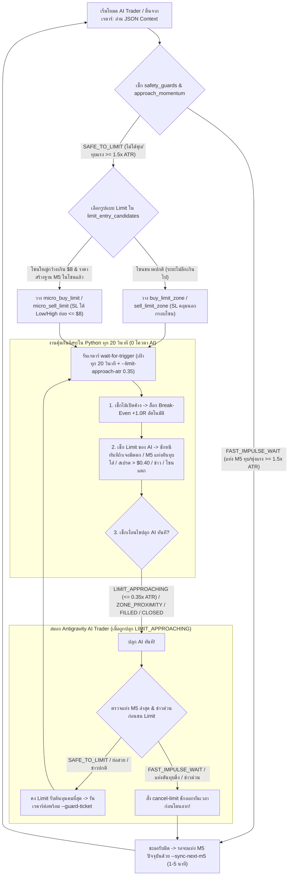

# XAU/USD Autonomous AI Trader Workflow (Mode 2 — Limit-First Immediate Execution & Pre-Fill Radar)

> **ข้อควรระวังก่อนเริ่มใช้งาน (ห้ามเปิดชนกับ `gold-loop` เดิม):**
> ระบบนี้ทำงานแยกอิสระจากโหมดที่ 1 (`gold-loop` / `gold-strategy`) 100% หากก่อนหน้านี้เปิด `gold-loop` ทิ้งไว้ใน Background ให้สั่งหยุด `gold-loop` ก่อนเริ่มโหมด AI Trader เพื่อไม่ให้ทั้งสองระบบแย่งกันวางหรือยกเลิก Limit

---

## 0. แผนภาพผังกระบวนการทำงาน (Limit-First Immediate & Pre-Fill Radar)



---

## 1. กฎเหล็ก Limit-First Execution Matrix (ห้ามรอยืนยันหลายชั้นจนตกรถ!)

1. **เลิกนิสัยนั่งรอแท่งยืนยันมือเปล่า (Immediate Limit Placement):**
   - ธรรมชาติของ `XAU/USD` เวลาแตะโซนสถาบันมักเด้งแรง `$5–$8` ทันที ถ้ารอแท่ง M5 ปิดยืนยันหลายชั้น ต้นทุนจะแพงขึ้นจนเกินเพดาน `Hard SL <= $8.00` (ตกรถ หรือโดนบีบ SL ลอยกลางอากาศ)
   - **ลำดับการฟันธงทันทีเมื่ออยู่ใน/จ่อโซน (`ZONE_PROXIMITY` หรือตรวจรอบปกติ):**
     1. ตรวจ `safety_guards.can_open_new_trade == true`
     2. ตรวจ `structure_map.approach_momentum` (`buy_side_status` สำหรับฝั่ง Demand หรือ `sell_side_status` สำหรับฝั่ง Supply):
        - **กรณี `SAFE_TO_LIMIT` (ไม่ได้ลง/ขึ้นเร็วแรง):** **บังคับวาง `place-limit` ดักไว้เลยทันที!** โดยอ่านจาก `structure_map.limit_entry_candidates` ตามลำดับความสำคัญ 3 ระดับ:
          * **Tier 1 (`GOLDEN_ZONE_CONFLUENCE`):** โซนซ้อนทับ Fibo Golden Zone (61.8%–78.6%) → วาง Limit ที่ `fibo_650` (หรือถอยมาใช้ `61.8%` / `overlap_mid` อัตโนมัติ) ได้ทันที (`IMMEDIATE_LIMIT_RELAXED` ลดเกณฑ์รอแท่งยืนยันลง)
          * **Tier 2 (`NEARBY_GOLDEN_ZONE_SHIFT`):** โซนใกล้สุดไม่ซ้อนทับ แต่มีโซนอื่นในระยะ `<= 1.5x ATR` ที่ซ้อนทับ Golden Zone → ย้าย Limit ไปดักที่โซนซ้อนทับนั้นแทนโซนตื้น (ภายใต้ `SL <= $8.00` และ `R:R >= 1.50`)
          * **Tier 3 (`TREND_PULLBACK_FIBO` / `H1_ROLE_REVERSAL`):** โซนซ้อนทับแนว Fibo Pullback ที่ใช้งานได้จริง (`38.2% – 61.8%` เช่น `38.2%` หรือ `50.0%`) หรือเป็นแนว **H1 Role Reversal** → วาง Limit ที่ระดับ Fibo `50.0%` / `38.2%` หรือช่วง 35% ลึกเข้าโซน พร้อมให้ Smart Radar คุม Knife Guard ตลอดเวลา
          * **Tier 4 (`NO_FIBO_SUPPORT` — บล็อก Blind Limit):** โซนตื้นลอยกลางอากาศที่อยู่เหนือ `38.2%` (เช่น เหนือ `23.6%`) และไม่ใช่ H1 Role Reversal → ระบบจะติด `passes_hard_gate = false` **ห้ามตั้ง Limit ดักลอยๆ เด็ดขาด!** ต้องรอแท่งเทียน M5/M15 ปิดยืนยันการกลับตัวชัดเจนเท่านั้น
          * **ท่าที่ 1 (โซนปกติ M15/H1):** ใช้ `buy_limit_zone` หรือ `sell_limit_zone` หาก `passes_hard_gate == true` และจุดเข้าไม่ลึกห่างราคาปัจจุบันเกินไป (`<= $6.50` หรือเป็น `GOLDEN_ZONE_CONFLUENCE` / `NEARBY_GOLDEN_ZONE_SHIFT`)
          * **ท่าที่ 2 (โซน H1/M15 กว้างเกิน \$8):** หากโซนกว้างมากจน `buy_limit_zone` ไปกองอยู่ก้นโซนลึกๆ แต่ราคาเริ่มสร้างฐานย่อย M5 ในโซนแล้ว ให้ใช้ **`micro_buy_limit` หรือ `micro_sell_limit`** (อิง SL ใต้ฐาน M5 ล่าสุดในงบ `<= $8.00`) เพื่อดักย่อรับของต้นน้ำทันทีโดยไม่ตกรถ!
          * **ท่าที่ 3 (โซนย่อย M5 สดใหม่กลางกรอบกว้าง `M5_ZONE_PROXIMITY`):** เมื่อกรอบ M15 กว้างมากแต่เกิดโซนย่อย M5 สดใหม่ (`retest_count <= 1`) ให้ตรวจรูปกราฟสกรีนดง Chop หากโครงสร้างสะอาดให้ใช้ **`m5_buy_limit_zone` หรือ `m5_sell_limit_zone`** ดักรับทันที (แต่ถ้าเป็นดง Sideway/Chop ไม่น่าเข้า ให้รันเรดาร์ต่อด้วย `--sync-next-m5` เพื่อไม่ให้ปลุกซ้ำที่โซนย่อยเดิมในวินาทีที่ 0)
        - **กรณี `FAST_IMPULSE_WAIT` (แท่ง M5 กระชากแรง `>= 1.5x ATR` เนื้อตัน):** ห้ามวางขวางมีดตก ให้รัน `wait-for-trigger --poll 15 --sync-next-m5` เพื่อรอแค่จบแท่ง 5 นาทีปัจจุบัน (ไม่เกิน 1–5 นาที) แล้วกลับมาวาง Limit ทันทีที่แรงทุบชะลอตัว

2. **ห้ามใช้ `--sniper-m5` นอนรอเฉยๆ 30 นาทีขณะมือเปล่า:**
   - เมื่อวาง `place-limit` เสร็จแล้ว ให้รันเรดาร์เกียร์หลักพร้อม `--limit-approach-atr 0.35` เสมอ (Python Watchdog จะคอยชักออเดอร์หนีให้อัตโนมัติทุก 20 วินาทีหากจู่ๆ เกิดแท่งมีดตก และจะปลุก AI ด้วย `LIMIT_APPROACHING` ก่อนราคาชนออเดอร์)
   - ใช้ `--sync-next-m5` เฉพาะตอนติด `FAST_IMPULSE_WAIT` เท่านั้น

3. **โหมดประหยัด Token (Token-Saving Context Mode — ค่ามาตรฐานแนะนำ):**
   - **รอบปกติ:** ดึงเฉพาะ JSON (`python -m src.execution.ai_trader_bridge context` ไม่ต้องใส่ `--chart` และไม่ต้อง `search_web` ข่าว)
   - **เปิดดูรูปกราฟ (`read_file` จาก `chart_artifacts.image_path`) และค้นเว็บข่าว (`search_web`) เฉพาะเมื่อ:**
     1. ราคาจ่อโซนเตรียมเข้าไม้ / เรดาร์ปลุก `LIMIT_APPROACHING` หรือ `ZONE_PROXIMITY` เพื่อสกรีนดง Sideway/Chop และข่าวด่วนก่อนรับไม้
     2. แท่ง M5 กระชากแรงผิดปกติ (`range_x_atr >= 1.5` หรือ `max_recent_m5_range_x_atr >= 1.5`)
   - **รูปแบบการตอบกลับ:** สรุปสั้นกระชับที่สุด **ไม่เกิน 3–4 บรรทัดต่อรอบ** (ราคา & สภาวะ, สถานะพอร์ต/Limit, การตัดสินใจ, สถานะเรดาร์)

4. **กฎเหล็กด้านตัวเลขและ `Hard Risk Gate`:**
   - ใช้รูปภาพกราฟเพื่อเช็กทรง Sideway/Chop เท่านั้น ห้ามกะราคาด้วยสายตา ต้องใช้ตัวเลขจาก JSON 100%
   - พอร์ต Cent `#160219615` ล็อก `XAUUSDc` ขนาด `0.06` Lot อัตโนมัติ, สูงสุด `1` ไม้, `Hard SL <= $8.00 USD`, `R:R >= 1.50`, และบล็อกทันทีเมื่อ `Spread > $0.40` หรือติด `News / Rollover Blackout`

---

## 2. ชุดคำสั่ง CLI เฉพาะโหมด AI Trader (`ai_trader_bridge.py`)

- **ดึงข้อมูล JSON โหมดประหยัด Token (รอบปกติ):**
  ```powershell
  python -m src.execution.ai_trader_bridge context
  ```
- **ดึงข้อมูลพร้อมวาดกราฟโซน Base (เฉพาะจังหวะจ่อโซน/เช็ก Chop):**
  ```powershell
  python -m src.execution.ai_trader_bridge context --chart --note "Inspect zone before limit fill"
  ```
- **วางคำสั่ง Pending Limit ดักต้นทุนคม (ท่าหลักบังคับใช้เมื่อ `SAFE_TO_LIMIT`):**
  ```powershell
  python -m src.execution.ai_trader_bridge place-limit --direction BUY --price <PRICE> --sl <SL> --tp <TP> --ttl 15 --reason "<เหตุผลเชิงกลยุทธ์>"
  ```
- **ยิงคำสั่ง Market Order ทันที (เฉพาะเมื่อราคาอยู่ในจุดต้นทุนดีมากในโซน `SL <= $8.00` และกำลังจะดีดหนี):**
  ```powershell
  python -m src.execution.ai_trader_bridge place-market --direction BUY --sl <SL> --tp <TP> --reason "<เหตุผลเชิงกลยุทธ์>"
  ```
- **ขยับ SL ล็อกกำไร / ปรับ TP / ยกเลิก Limit / ปิดไม้หนีภัย:**
  ```powershell
  python -m src.execution.ai_trader_bridge modify-sltp --ticket <ID> --sl <NEW_SL> --tp <NEW_TP> --reason "<เหตุผล>"
  python -m src.execution.ai_trader_bridge cancel-limit --reason "<เหตุผล>"
  python -m src.execution.ai_trader_bridge close --ticket <ID> --reason "<เหตุผล>"
  ```

---

## 3. วงจรเรดาร์ 3 เกียร์ (Event-Driven Reactive Wakeup — Live Log ตลอดเวลา)

หลังจากตัดสินใจในแต่ละรอบเสร็จ ให้สั่งรัน `wait-for-trigger` ด้วย `run_command` โดยตั้ง **`IsDaemon=false`**, **`WaitMsBeforeAsync=1500`**, และตั้ง `NotificationTimeoutSeconds` ให้ครอบคลุม `--max-wait` แล้วจบเทิร์นทันที:

1. **เกียร์หลัก Smart Radar (เฝ้าโซน M15/H1 + โซนย่อย M5 + ปลุกเมื่อขยับ `>= 1.0x ATR` + ปลุกล่วงหน้าก่อนชน Limit `<= 0.35x ATR` + ยกเลิกอัตโนมัติเมื่อราคาถึง TP ก่อนรับไม้):**
   ```powershell
   python -m src.execution.ai_trader_bridge wait-for-trigger --poll 20 --max-wait 1800 --proximity-atr 0.7 --limit-approach-atr 0.35 --displacement-atr 1.0
   ```
2. **เกียร์ยืนยันรับไม้ (หลังจาก AI ตื่นมาตรวจ `LIMIT_APPROACHING` แล้วอนุมัติให้คง Limit รับออเดอร์ต่อ):**
   ```powershell
   python -m src.execution.ai_trader_bridge wait-for-trigger --poll 20 --max-wait 1800 --proximity-atr 0.7 --guard-ticket <TICKET>
   ```
3. **เกียร์รอจบแท่ง M5 ปัจจุบันเมื่อเจอแท่งพุ่ง/ทุบแรง (`FAST_IMPULSE_WAIT`):**
   ```powershell
   python -m src.execution.ai_trader_bridge wait-for-trigger --poll 15 --sync-next-m5
   ```
