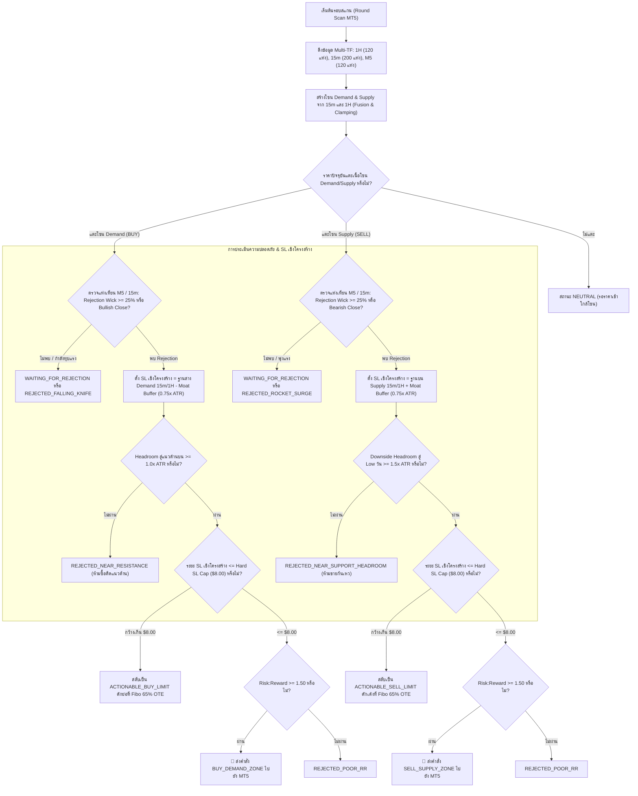

# XAU/USD Multi-Timeframe M5 Execution & Structural SL Workflow

Workflow นี้สรุปขั้นตอนการทำงานและผังการตัดสินใจทั้งหมดของระบบ AutoTrade ทองคำ (XAUUSD / XAUUSDc) ตามสถาปัตยกรรม 3 กรอบเวลา (Top-Down Execution):
1. **1H (ชั่วโมง):** คุม Macro Structure, Major Fibonacci Swings, และโซน Base แม่บท
2. **15m (15 นาที):** คำนวณ ATR, แนวโน้ม EMA15/MA50, Headroom Guard, และกรอบแนวรับ-แนวต้านหลัก
3. **M5 (5 นาที):** เป็น **Sniper Execution Trigger** ดักจับแท่งเทียนกลับตัว (Rejection Wick $\ge 25\%$) เมื่อราคาแตะเข้าเนื้อโซน

---

## 1. แผนภาพผังกระบวนการตัดสินใจ (Decision Flowchart)

---

## 2. กฎหลัก 4 ข้อของ Workflow

### กฎข้อที่ 1: การลั่นไกด้วยแท่งเทียน 5 นาที (M5 Sniper Trigger)
- เมื่อราคาเดินทางเข้าใกล้หรือสัมผัสขอบโซนของ 15m/1H ระบบจะซูมเข้าตรวจแท่งเทียน M5 ล่าสุด
- **ฝั่ง BUY:** ต้องการหางล่าง (Lower Wick) $\ge 25\%$ ของความยาวแท่ง หรือแท่งเขียวปิดพ้นกึ่งกลางฐาน
- **ฝั่ง SELL:** ต้องการหางบน (Upper Wick) $\ge 25\%$ ของความยาวแท่ง หรือแท่งแดงปิดพ้นกึ่งกลางฐาน
- **ข้อดี:** ตรวจพบการกลับตัวได้เร็วกว่าแท่ง 15m ถึง 3 เท่า ได้ราคาต้นทุนชิดฐานแนวรับ/ต้านมากที่สุด

### กฎข้อที่ 2: การรักษา Stop Loss เชิงโครงสร้าง (Structural SL Protection)
- **ห้ามบีบ SL ให้แคบเกินธรรมชาติเด็ดขาด:** เพื่อป้องกันไม่ให้ถูก Spread หรือไส้เทียนของตลาดทองคำกวาดกินฟรี (Stop-Hunt Noise)
- จุด Stop Loss ต้องคำนวณจาก:
  - **ฝั่ง BUY:** $\text{SL} = \text{ขอบล่างของ Demand Zone (15m/1H)} - \text{Moat Buffer}$
  - **ฝั่ง SELL:** $\text{SL} = \text{ขอบบนของ Supply Zone (15m/1H)} + \text{Moat Buffer}$
  - โดยที่ $\text{Moat Buffer} = (0.75 \times \text{ATR}) + \text{Broker Spread}$

### กฎข้อที่ 3: เพดานความเสี่ยงและการถอยไปใช้ Limit Order (Hard SL Cap $\le \$8.00$)
- **เพดานขาดทุนสูงสุด:** ระยะห่างจากจุดเข้าถึง SL ต้อง **ไม่เกิน $8.00 USD (80 pips)**
- **หากความผันผวนสูงจน SL กว้างเกิน $8.00:**
  - ระบบจะปฏิเสธการกด Market Order ทันที
  - และสลับไปแนะนำโหมด **Pending Limit Order** ดักรอที่ระดับ **Fibonacci 65.0% (OTE)** เพื่อดึงระยะ SL ให้แคบลงมาอยู่ในกรอบปลอดภัย

### กฎข้อที่ 4: การตั้งเป้าหมายทำกำไร (Front-Running Take Profit)
- **ไม่ตั้ง TP ลึกเข้าไปในแนวต้าน/แนวรับตรงๆ:** เพราะเสี่ยงที่ราคาจะลงไปไม่ถึงแล้ววกกลับ
- **สูตรคำนวณ:** $\text{TP} = \text{ขอบแนวต้าน/แนวรับถัดไป} \pm (0.35 \times \text{ATR})$
- ป้องกันปัญหากำไรทิพย์ พร้อมล็อกผลตอบแทน Risk:Reward $\ge 1.50$ เสมอ
