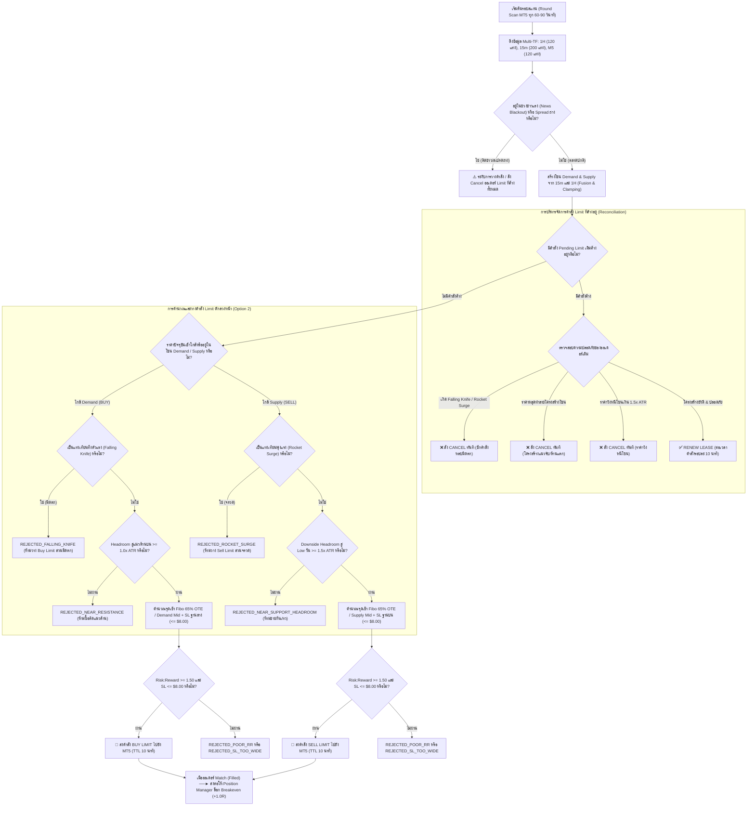

# XAU/USD Dynamic Limit Order & Structural SL Workflow (V2.0)

Workflow นี้สรุปขั้นตอนการทำงานและผังการตัดสินใจของระบบ AutoTrade ทองคำ (XAUUSD / XAUUSDc) ตามสถาปัตยกรรม **Dynamic Limit Order Management (Option 2)**:
1. **1H (ชั่วโมง):** คุม Macro Structure, Major Fibonacci Swings, และโซน Base แม่บท
2. **15m (15 นาที):** คำนวณ ATR, แนวโน้ม EMA15/MA50, Headroom Guard, และกรอบแนวรับ-แนวต้านหลัก
3. **Dynamic Limit Placement:** วางคำสั่ง **Pending Limit Order (Buy Limit / Sell Limit)** ดักล่วงหน้าที่ระดับ **Fibonacci 65.0% OTE หรือกึ่งกลางโซน Base (Discount 50%)** โดยไม่ต้องรอแท่งเทียนปิด ทำให้ได้ราคาต้นทุนคมที่สุดและระยะ SL แคบลง ($\le \$8.00$)
4. **Order Lifecycle Manager (ลูปตรวจทุก 60-90 วินาที):** บอททำหน้าที่คอยตรวจสอบคำสั่ง Limit ที่ค้างอยู่ หากพบแท่งเทียนทิ้งตัวแรง (Falling Knife) หรือแนวรับแตก จะสั่ง **Cancel / ยกเลิกคำสั่งทันที** เพื่อไม่ให้รับมีดตก

---

## 1. แผนภาพผังกระบวนการตัดสินใจ (Decision Flowchart)



---

## 2. กฎหลัก 4 ข้อของระบบ Dynamic Limit (Option 2)

### กฎข้อที่ 1: การวางคำสั่ง Limit ดักล่วงหน้าที่จุดได้เปรียบ (Pre-placement)
- **ไม่ไล่ซื้อ/ขายด้วย Market Order:** เพื่อหลีกเลี่ยงการติดดอยหรือขายก้นเหว
- **จุดเข้าคำสั่ง (Entry):** วางที่ระดับ **Fibonacci 65.0% OTE หรือกึ่งกลางโซน Base (Discount 50%)**
- **จุดตัดขาดทุน (Stop Loss):** วางหลังฐานโซนบวก Moat Buffer ($0.75\times\text{ATR} + \text{Spread}$) โดยระยะห่าง **ต้องไม่เกิน $8.00 USD (80 pips) เสมอ**
- **เป้าหมายทำกำไร (Take Profit):** ดักเก็บกำไรหน้าแนวรับ/ต้านถัดไป ($R:R \ge 1.50$)

### กฎข้อที่ 2: วงจรตรวจสอบและยกเลิกออเดอร์อัตโนมัติ (Zero-Ghost & Knife-Guard)
- คำสั่ง Limit ใน MT5 จะมีอายุเริ่มต้น 10 นาที (Server-side TTL) เพื่อป้องกันคำสั่งค้างหากบอทหยุดทำงาน
- ในแต่ละรอบที่บอทประมวลผล (ทุก 60–90 วินาที) บอทจะตรวจสอบ:
  1. หากมีแท่งแดงทึบดิ่งลงมา (Falling Knife) $\rightarrow$ **สั่งลบ Buy Limit ทิ้งทันที** เพื่อไม่ให้รับมีดตก
  2. หากราคาหลุดทะลุแนวรับ/ต้านหลัก $\rightarrow$ **สั่งลบ Limit ทิ้งทันที**
  3. หากเข้าสู่ช่วงข่าวสหรัฐฯ (News Blackout) หรือสเปรดถ่าง $\rightarrow$ **สั่งลบ Limit ทิ้งทันที**

### กฎข้อที่ 3: การเลื่อนบังทุนอัตโนมัติ (Breakeven Lock)
- ทันทีที่คำสั่ง Limit ถูกเกี่ยว (Filled) และราคาเริ่มวิ่งไปในทิศทางที่ถูกต้องจนมีกำไรลอยตัว $\ge +1.0\times R$
- ระบบจะปรับ Stop Loss ขึ้นมาบังหน้าทุนทันที (`Entry ± (Live Spread + $0.10)`) เพื่อเปลี่ยนสถานะเป็น **Free Trade** คุ้มครองเงินทุน 100%

### กฎข้อที่ 4: การทำงานแบบ Full Auto ในคำสั่งเดียว
- คำสั่งรันผ่าน Bridge CLI:
  ```bash
  python -m src.execution.agent_bridge gold-strategy --symbol XAUUSDc --manage-limits
  ```
  หรือสั่งรันลูปต่อเนื่อง:
  ```bash
  python -m src.execution.agent_bridge gold-loop --interval 60
  ```
