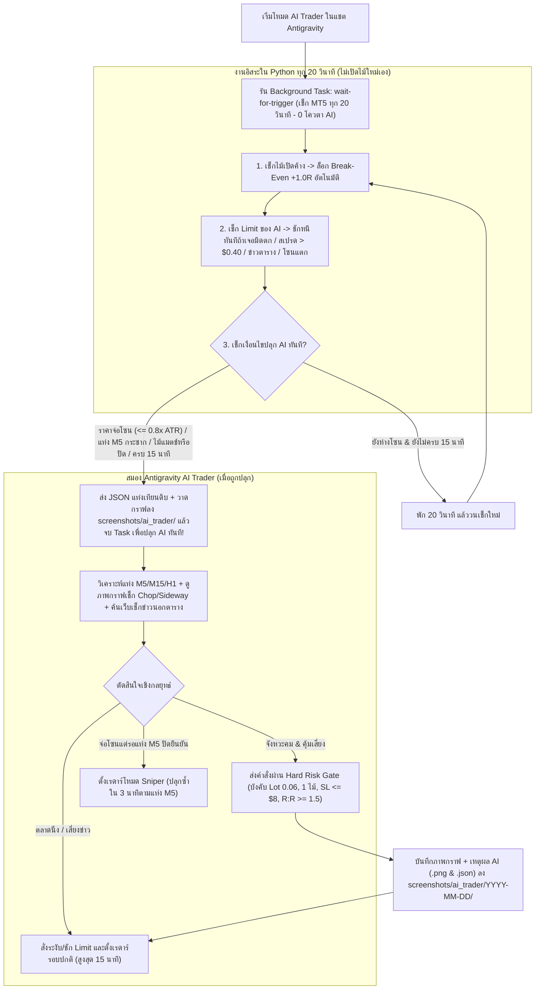

# XAU/USD Autonomous AI Trader Workflow (Mode 2 — Coexists with Mode 1)

> **ข้อควรระวังก่อนเริ่มใช้งาน (ห้ามเปิดชนกับ `gold-loop` เดิม):**
> ระบบนี้ทำงานแยกอิสระจากโหมดที่ 1 (`gold-loop` / `gold-strategy`) 100% หากก่อนหน้านี้เปิด `gold-loop` ทิ้งไว้ใน Background ให้สั่งหยุด `gold-loop` ก่อนเริ่มโหมด AI Trader เพื่อไม่ให้ทั้งสองระบบแย่งกันวางหรือยกเลิก Limit

---

## 0. แผนภาพผังกระบวนการทำงาน (AI Trader & 20s Radar Flowchart)



---

## 1. บทบาทและกฎเหล็กของ Antigravity ในโหมด AI Trader

1. **วิเคราะห์ด้วยตรรกะเทรดเดอร์จริง (ไม่ใช่แค่สรุปผล EA):**
   - อ่าน `raw_candles` ทั้ง `H1`, `M15`, และ `M5` (ดูขนาดเนื้อเทียน, `% ไส้เทียนบน/ล่าง`, การสร้างฐาน W / Higher Low / Lower High, Liquidity Sweep ตาม `[XAU-RULE-20]` และ `[XAU-RULE-24]`)
   - หากมีไฟล์ภาพใน `chart_artifacts.image_path` ให้ใช้เครื่องมือ `read_file` เปิดดูภาพกราฟ **เพื่อเช็กด้วยตาเปล่าว่าโซนไม่ได้อยู่ในดง Sideway/Chop เละเทะเท่านั้น**
   - **กฎเหล็กด้านตัวเลข:** **ห้ามกะระยะราคา Entry / SL / TP จากรูปภาพเด็ดขาด!** ต้องใช้ตัวเลขจาก JSON 100%
   - ใช้ `search_web` เช็กข่าวด่วนนอกตาราง (Fed, ภูมิรัฐศาสตร์, ตัวเลขสหรัฐฯ) ก่อนเปิดไม้หรือเมื่อเห็นแท่งกระชากผิดปกติ

2. **ด่านบังคับความปลอดภัยอัตโนมัติในโค้ด (`Hard Risk Gate`):**
   - พอร์ต Cent `#160219615` ล็อกคู่เงิน `XAUUSDc` และขนาด `0.06` Lot อัตโนมัติ (Demo ล็อก `0.01` Lot)
   - ห้ามมีออเดอร์เปิดเกิน `1` ไม้ (Single-Position Guard)
   - ระยะ `Hard SL` ต้อง `<= $8.00 USD` และ `R:R >= 1.50` เสมอ
   - บล็อกการเข้าใหม่ทันทีเมื่อ `Spread > $0.40`, ติด `News Blackout`, หรือ `Rollover Blackout`

---

## 2. ชุดคำสั่ง CLI เฉพาะโหมด AI Trader (`ai_trader_bridge.py`)

- **ดึงข้อมูลแท่งเทียนดิบ + โซน + พอร์ต (ใส่ `--chart` เมื่อต้องการวาดรูปเช็กทรงกราฟ):**
  ```powershell
  python -m src.execution.ai_trader_bridge context --chart --note "Inspect zone structure"
  ```
- **วางคำสั่ง Pending Limit ดักต้นทุนคม (แนะนำเป็นหลักเมื่อรอราคาสะบัดเกี่ยว OTE 65% / ขอบ Base):**
  ```powershell
  python -m src.execution.ai_trader_bridge place-limit --direction BUY --price <PRICE> --sl <SL> --tp <TP> --ttl 15 --reason "<เหตุผลเชิงกลยุทธ์>"
  ```
- **ยิงคำสั่ง Market Order ทันที (เมื่อแท่ง M5 ปิดยืนยันการกลับตัวในโซนและต้นทุนยังไม่วิ่งหนี):**
  ```powershell
  python -m src.execution.ai_trader_bridge place-market --direction BUY --sl <SL> --tp <TP> --reason "<เหตุผลเชิงกลยุทธ์>"
  ```
- **ขยับ SL ล็อกกำไร / ปรับ TP / ยกเลิก Limit / ปิดไม้หนีภัยก่อนถึง TP:**
  ```powershell
  python -m src.execution.ai_trader_bridge modify-sltp --ticket <ID> --sl <NEW_SL> --tp <NEW_TP> --reason "<เหตุผล>"
  python -m src.execution.ai_trader_bridge cancel-limit --reason "<เหตุผล>"
  python -m src.execution.ai_trader_bridge close --ticket <ID> --reason "<เหตุผล>"
  ```

---

## 3. วงจรเรดาร์ 2 เกียร์ (Event-Driven Reactive Wakeup — 0 โควตาระหว่างรอ)

หลังจากวิเคราะห์และตัดสินใจในแต่ละรอบเสร็จ ให้สั่งรัน `wait-for-trigger` ด้วย `run_command` โดยตั้ง **`IsDaemon=false`**, **`WaitMsBeforeAsync=1000`**, และ **`NotificationTimeoutSeconds=960`** แล้วจบเทิร์นทันที (ไม่ต้องตั้ง Timer ซ้ำซ้อน):

1. **เกียร์ปกติ (ราคายังห่างโซน / มีไม้เปิดหรือวาง Limit ไว้แล้ว):**
   ```powershell
   python -m src.execution.ai_trader_bridge wait-for-trigger --poll 20 --max-wait 900 --proximity-atr 0.8
   ```
   - สคริปต์จะเฝ้า MT5 ทุก 20 วินาที คอยล็อก **Break-Even `+1.0R`** และชัก Limit หนีมีดตกให้เอง
   - หากราคาวิ่งเข้าจ่อโซน (`<= 0.8x ATR`) หรือไม้ถูกเกี่ยว/ปิด สคริปต์จะวาดกราฟเก็บลง `screenshots/ai_trader/YYYY-MM-DD/` และ **จบการทำงานเพื่อปลุก AI ในแชตทันที!** (หากตลาดนิ่งจะปลุกทุก 15 นาที)

2. **เกียร์ซุ่มสไนเปอร์ M5 (ราคาอยู่ในโซนแล้ว แต่ AI รอดูแท่ง M5 ถัดไปปิดจบแท่ง):**
   ```powershell
   python -m src.execution.ai_trader_bridge wait-for-trigger --poll 20 --max-wait 180 --sniper-m5
   ```
   - เฝ้าความปลอดภัยทุก 20 วินาทีเหมือนเดิม แต่จะรอครบ 3 นาทีเพื่อให้แท่ง `M5` สร้างตัว/ปิดแท่งใหม่ แล้วปลุก AI พร้อมรูปกราฟสดทันทีโดยไม่ปลุกซ้ำรัวๆ ในวินาทีเดิม

---

## 4. ตัวอย่าง Prompt สำหรับสั่งสลับใช้งานทั้ง 2 โหมด

- **สั่งรันโหมดที่ 2 (AI Trader เต็มรูปแบบ):**
  > "เริ่มเทรดทองคำด้วยโหมด AI Trader ตาม workflow `xauusd-ai-trader-workflow` ได้เลยครับ อนุญาตให้อ่านแท่งเทียนดิบ เช็กกราฟและข่าวด่วน แล้วตัดสินใจออกออเดอร์/วาง Limit/ดูแลไม้เองภายใต้ Hard Risk Gate พร้อมเปิดเรดาร์ `wait-for-trigger` เฝ้าปลุกอัตโนมัติได้เลย"

- **สั่งกลับไปใช้โหมดที่ 1 (ระบบ EA เดิมที่คุณคุ้นเคย):**
  > "หยุดเรดาร์ AI Trader แล้วสลับกลับไปรัน `gold-loop` ทุก 60 วินาทีตามระบบเดิม (`xauusd-m5-execution-workflow`) แทนครับ"
